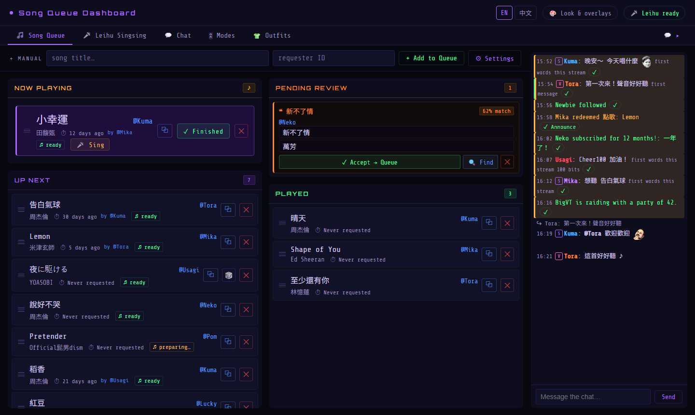
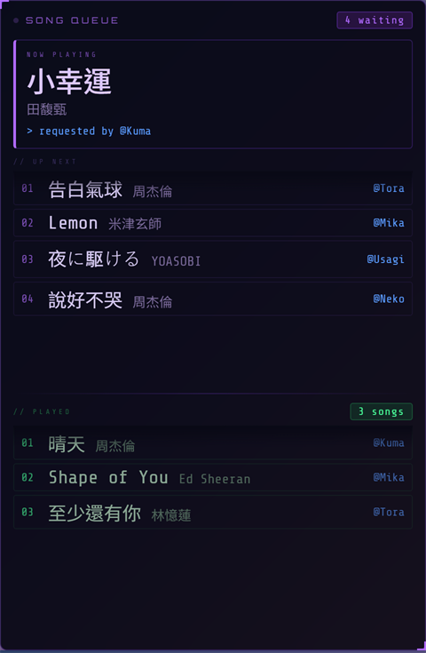
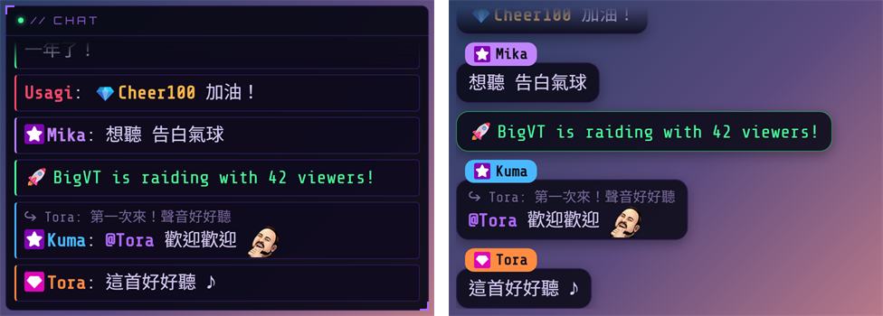
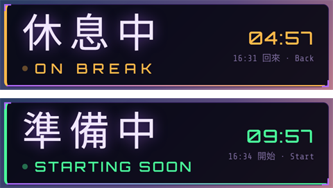
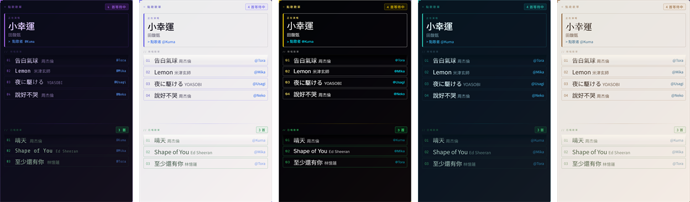

# 🎵 VTuber Song Queue

A song request system for Twitch streamers: viewers request songs with channel points, the song list shows on
stream, and one dashboard runs the requests, the chat and your stream's scenes. It runs on your own PC, free and open source.

**[繁體中文](README.md)** · **[Starter Guide (from scratch)](docs/STARTER_GUIDE.md)** · **[Download the latest release](https://github.com/sheng7337/twitch-song-request-system/releases/latest)** · **[Changelog](CHANGELOG.md)**



---

## What it does

### 🎵 Channel-point song requests
- Viewers redeem "Request a song" and type a title; it's matched against your song list in Google Sheets — exact,
  misspelled, romanized or kana titles all work. Songs it can't find wait in Pending Review for you to decide.
- A **random song** reward, optionally from one tab only (e.g. "Random Japanese song"); songs sung recently cool
  down for a few days, and songs nobody has asked for in a while come up more often.
- Each song shows when it was last requested and by whom; the queue survives a restart mid-stream.
- Tick which sheet tabs can be requested (songs you're still practising stay out).



### 🎤 Leihu Singsing (optional)
Works with [Leihu Singsing](https://github.com/LeihuTW/Leihu-singsing), which makes backing tracks and timed lyrics from YouTube.
- Requested songs can get their backing track ready by themselves; **🎤 Sing** opens the song in Leihu at its key.
- Leihu shows in a dashboard tab; prepare the whole sheet ahead, and find YouTube links for it.

### 💬 Chat
- Live chat beside every tab: search, filters, earlier streams. What to thank or greet on stream (first chats,
  subs, bits, raids, redemptions) is highlighted.
- Send and reply, ban / timeout, Shoutout, raid, pin, and complete or refund redemptions — from the dashboard.
- **Chat on stream** (instead of OneComme): four styles, Twitch badges and emotes; deleted messages leave at once.



### 🎛 Modes
"🎤 Singing", "💬 Talking", "☕ Break"… one click sets Streamlabs Desktop or OBS — scene, which sources show,
positions and audio — and can hold clips, post in chat and switch the dashboard tab.

### 🎬 Clips, thank-you rolls and raids
- `!so` sends a Shoutout and plays one of their clips; `!watch` plays a Twitch clip or YouTube video.
- `!tk` thank-you roll and `!endingtk` ending roll: raiders, subs, bits, new followers, redemptions, requests and
  the most active chatters.
- **Raid with the ending roll**: the roll is timed so the raid goes 10 seconds after it ends.

### 👕 Outfits (veadotube mini)
Viewers redeem a reward, a card pops up, and you click the outfit to wear; it can go back to your default after a few minutes.

### ☕ Break and starting-soon cards
Countdown cards for your stream: add `?min=10` or `?at=20:00` to the address.



### 🎨 Themes and text sizes
Five themes (Neon, Daylight, High contrast, Ocean, Cream & coffee), picked apart for the dashboard and the overlays,
and adjustable text sizes that keep the layout. The dashboard works on a phone too, in English or 繁體中文.



---

## What you need

- A Windows PC with [Node.js LTS](https://nodejs.org)
- A Twitch account (with two-factor authentication on, to register a Twitch app)
- A Google account: your song list lives in Google Sheets
- OBS Studio or Streamlabs Desktop
- Optional: [Leihu Singsing](https://github.com/LeihuTW/Leihu-singsing), veadotube mini

---

## Getting started

**New, with no song list yet?** Start with the [Starter Guide](docs/STARTER_GUIDE.md) — no coding needed.

**First install**: install [Node.js LTS](https://nodejs.org), double-click `start.bat` and follow the setup wizard in your browser.

**Every stream**: double-click `start.bat`. The dashboard is at `http://localhost:3000/dashboard`.

**Updating**: read **⚠ Action needed** in [the latest release](https://github.com/sheng7337/twitch-song-request-system/releases/latest), then follow [Updating to a new version](docs/STARTER_GUIDE.md#12-updating-to-a-new-version) — your settings aren't overwritten.

> The full guide is [SETUP.md](SETUP.md); setting up by hand without the wizard: [SETUP_MANUAL.md](SETUP_MANUAL.md).

---

## OBS Browser Sources

**🎨 Look & overlays** at the top of the dashboard lists each address and size, with **Copy**.

| Source | Address | Size |
|---|---|---|
| Song list | `http://localhost:3000/overlay/index.html` | 960×1470, scaled to 50% in your scene (480×735) |
| Clip player | `http://localhost:3000/clip-player/index.html` | 1920×1080 |
| Chat | `http://localhost:3000/overlay/chat.html?style=panel` (or `bubble`, `list`, `row` for one line) | e.g. 960×1080 (`row`: 3840×200), scaled to 50% |
| On break card | `http://localhost:3000/overlay/break.html` | 960×260, scaled to 50% |
| Starting soon card | `http://localhost:3000/overlay/break.html?card=opening` | 960×260, scaled to 50% |

Custom CSS for the song list:
```css
body { background-color: rgba(0, 0, 0, 0) !important; margin: 0px auto; overflow: hidden; }
```

---

## Chat commands (mods / broadcaster)

| Command | What it does |
|---|---|
| `!so <channel>` | Sends Twitch's Shoutout, plays a random clip of that channel, and adds it to the thank-you roll |
| `!tk` | Plays the thank-you roll of every `!so` this stream |
| `!endingtk` | The ending roll: raiders, subs, bits, new followers, redemptions, requests and the most active chatters |
| `!watch <url>` | Plays a Twitch clip, YouTube or video link |
| `!replay` | Plays the last clip again |
| `!stop` | Stops what's playing now |

**Roll backgrounds**: put pictures (jpg / png / gif / webp) in `clip-player/sponsor-bgs/`, as many as you like; one
is picked at random each time. Restart to pick up new ones. With none there, the background is dark.

---

## License

[MIT](LICENSE). Leihu Singsing is separate software with its own license.
